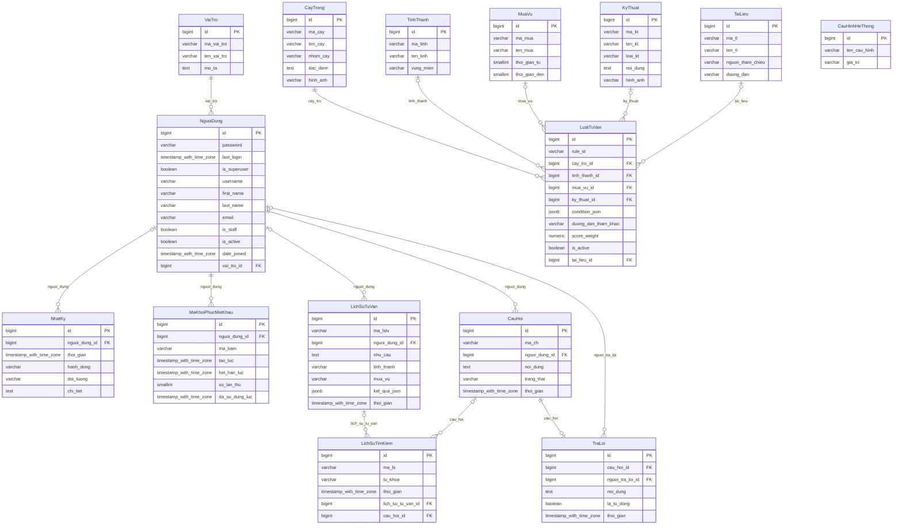

# Từ điển dữ liệu

Sinh tự động từ mã nguồn: **15 bảng** trong 6 app (chưa tính các bảng của Django như phiên đăng nhập, loại nội dung, quyền).
Kiểu dữ liệu là kiểu thật trong PostgreSQL.

| Bảng (class) | App | Ý nghĩa |
|---|---|---|
| taikhoan_vaitro (VaiTro) | taikhoan | Vai trò phân quyền: ADMIN, BIEN_TAP, CHUYEN_GIA, NONG_DAN. |
| taikhoan_nguoidung (NguoiDung) | taikhoan | Người dùng hệ thống: kế thừa AbstractUser, thêm vai trò. |
| taikhoan_nhatky (NhatKy) | taikhoan | Nhật ký hành động quan trọng. |
| taikhoan_makhoiphucmatkhau (MaKhoiPhucMatKhau) | taikhoan | Mã khôi phục email đã băm, hết hạn sau thời gian ngắn và chỉ dùng một lần. |
| danhmuc_caytrong (CayTrong) | danhmuc | Cây trồng |
| danhmuc_tinhthanh (TinhThanh) | danhmuc | Tỉnh thành |
| danhmuc_muavu (MuaVu) | danhmuc | Mùa vụ lặp lại hằng năm: lưu tháng bắt đầu và tháng kết thúc (1-12). |
| danhmuc_kythuat (KyThuat) | danhmuc | Kỹ thuật |
| danhmuc_tailieu (TaiLieu) | danhmuc | Tài liệu tham chiếu (WASI, Sở Nông nghiệp...) dùng cho truy xuất nguồn gốc. |
| tuvan_luattuvan (LuatTuVan) | tuvan | Một luật tư vấn lưu trong CSDL (không hardcode trong mã nguồn). |
| tuvan_lichsutuvan (LichSuTuVan) | tuvan | Lưu toàn bộ đầu vào và đầu ra (JSON) của mỗi lần bấm «Xem kết quả». |
| timkiem_lichsutimkiem (LichSuTimKiem) | timkiem | Lịch sử tìm kiếm |
| hoidap_cauhoi (CauHoi) | hoidap | Câu hỏi |
| hoidap_traloi (TraLoi) | hoidap | Câu trả lời của chuyên gia, hoặc câu trả lời tiêu chuẩn tự động khi câu hỏi ngoài phạm vi (la_tu_dong=True). |
| cauhinh_cauhinhhethong (CauHinhHeThong) | cauhinh | Cặp tên - giá trị. Dùng lưu trọng số w1, w2, w3 của công thức tính điểm tư vấn. |

## Sơ đồ quan hệ (ERD)

Ký hiệu: `||--o{` một-nhiều bắt buộc; `|o--o{` một-nhiều tùy chọn (khóa ngoại cho phép NULL); `||--o|` một-một.

## VaiTro (`taikhoan_vaitro`)

Vai trò phân quyền: ADMIN, BIEN_TAP, CHUYEN_GIA, NONG_DAN.

| Cột | Kiểu (PostgreSQL) | Ràng buộc | Ý nghĩa |
|---|---|---|---|
| id | bigint | khóa chính; NOT NULL | ID |
| ma_vai_tro | varchar(30) | duy nhất; NOT NULL | Mã vai trò |
| ten_vai_tro | varchar(100) | NOT NULL | Tên vai trò |
| mo_ta | text | NOT NULL | Mô tả |

## NguoiDung (`taikhoan_nguoidung`)

Người dùng hệ thống: kế thừa AbstractUser, thêm vai trò.

| Cột | Kiểu (PostgreSQL) | Ràng buộc | Ý nghĩa |
|---|---|---|---|
| id | bigint | khóa chính; NOT NULL | ID |
| password | varchar(128) | NOT NULL | Mật khẩu |
| last_login | timestamp with time zone | cho phép NULL | Lần cuối đăng nhập |
| is_superuser | boolean | NOT NULL; mặc định False | trạng thái superuser |
| username | varchar(150) | duy nhất; NOT NULL | Tên đăng nhập |
| first_name | varchar(150) | NOT NULL | Tên |
| last_name | varchar(150) | NOT NULL | Họ |
| email | varchar(254) | NOT NULL | địa chỉ email |
| is_staff | boolean | NOT NULL; mặc định False | tình trạng nhân viên |
| is_active | boolean | NOT NULL; mặc định True | Kích hoạt |
| date_joined | timestamp with time zone | NOT NULL; mặc định thời điểm hiện tại | Ngày tham gia |
| vai_tro_id | bigint | khóa ngoại → VaiTro (PROTECT); NOT NULL | Vai trò |

Kế thừa `AbstractUser` của Django nên có thêm các cột chuẩn (mật khẩu đã băm, lần đăng nhập cuối, ngày tạo...). Các quan hệ nhiều-nhiều `groups`, `user_permissions` của Django không được dùng (phân quyền theo `vai_tro`).

## NhatKy (`taikhoan_nhatky`)

Nhật ký hành động quan trọng.

| Cột | Kiểu (PostgreSQL) | Ràng buộc | Ý nghĩa |
|---|---|---|---|
| id | bigint | khóa chính; NOT NULL | ID |
| nguoi_dung_id | bigint | khóa ngoại → NguoiDung (SET_NULL); cho phép NULL | Người dùng |
| thoi_gian | timestamp with time zone | NOT NULL; mặc định thời điểm hiện tại; có chỉ mục | Thời gian |
| hanh_dong | varchar(100) | NOT NULL | Hành động |
| doi_tuong | varchar(200) | NOT NULL | Đối tượng |
| chi_tiet | text | NOT NULL | Chi tiết |

## MaKhoiPhucMatKhau (`taikhoan_makhoiphucmatkhau`)

Mã khôi phục email đã băm, hết hạn sau thời gian ngắn và chỉ dùng một lần.

| Cột | Kiểu (PostgreSQL) | Ràng buộc | Ý nghĩa |
|---|---|---|---|
| id | bigint | khóa chính; NOT NULL | ID |
| nguoi_dung_id | bigint | khóa ngoại → NguoiDung (CASCADE); NOT NULL | Người dùng |
| ma_bam | varchar(128) | NOT NULL | Mã đã băm |
| tao_luc | timestamp with time zone | NOT NULL; mặc định thời điểm hiện tại; có chỉ mục | Thời gian tạo |
| het_han_luc | timestamp with time zone | NOT NULL; có chỉ mục | Thời gian hết hạn |
| so_lan_thu | smallint | NOT NULL; mặc định 0 | Số lần nhập sai |
| da_su_dung_luc | timestamp with time zone | cho phép NULL | Thời gian sử dụng |

## CayTrong (`danhmuc_caytrong`)

Cây trồng

| Cột | Kiểu (PostgreSQL) | Ràng buộc | Ý nghĩa |
|---|---|---|---|
| id | bigint | khóa chính; NOT NULL | ID |
| ma_cay | varchar(30) | duy nhất; NOT NULL | Mã cây |
| ten_cay | varchar(150) | NOT NULL | Tên cây |
| nhom_cay | varchar(20) | NOT NULL; giá trị: CONG_NGHIEP (Cây công nghiệp), AN_QUA (Cây ăn quả), NGAN_NGAY (Cây ngắn ngày) | Nhóm cây |
| dac_diem | text | NOT NULL | Đặc điểm |
| hinh_anh | varchar(100) | NOT NULL | Hình ảnh |

## TinhThanh (`danhmuc_tinhthanh`)

Tỉnh thành

| Cột | Kiểu (PostgreSQL) | Ràng buộc | Ý nghĩa |
|---|---|---|---|
| id | bigint | khóa chính; NOT NULL | ID |
| ma_tinh | varchar(30) | duy nhất; NOT NULL | Mã tỉnh |
| ten_tinh | varchar(100) | NOT NULL | Tên tỉnh |
| vung_mien | varchar(100) | NOT NULL; mặc định 'Tây Nguyên' | Vùng miền |

## MuaVu (`danhmuc_muavu`)

Mùa vụ lặp lại hằng năm: lưu tháng bắt đầu và tháng kết thúc (1-12).

| Cột | Kiểu (PostgreSQL) | Ràng buộc | Ý nghĩa |
|---|---|---|---|
| id | bigint | khóa chính; NOT NULL | ID |
| ma_mua | varchar(30) | duy nhất; NOT NULL | Mã mùa |
| ten_mua | varchar(100) | NOT NULL | Tên mùa |
| thoi_gian_tu | smallint | NOT NULL | Từ tháng |
| thoi_gian_den | smallint | NOT NULL | Đến tháng |

## KyThuat (`danhmuc_kythuat`)

Kỹ thuật

| Cột | Kiểu (PostgreSQL) | Ràng buộc | Ý nghĩa |
|---|---|---|---|
| id | bigint | khóa chính; NOT NULL | ID |
| ma_kt | varchar(30) | duy nhất; NOT NULL | Mã kỹ thuật |
| ten_kt | varchar(200) | NOT NULL | Tên kỹ thuật |
| loai_kt | varchar(100) | NOT NULL | Loại kỹ thuật |
| noi_dung | text | NOT NULL | Nội dung |
| hinh_anh | varchar(100) | NOT NULL | Hình ảnh |

## TaiLieu (`danhmuc_tailieu`)

Tài liệu tham chiếu (WASI, Sở Nông nghiệp...) dùng cho truy xuất nguồn gốc.

| Cột | Kiểu (PostgreSQL) | Ràng buộc | Ý nghĩa |
|---|---|---|---|
| id | bigint | khóa chính; NOT NULL | ID |
| ma_tl | varchar(30) | duy nhất; NOT NULL | Mã tài liệu |
| ten_tl | varchar(255) | NOT NULL | Tên tài liệu |
| nguon_tham_chieu | varchar(255) | NOT NULL | Nguồn tham chiếu |
| duong_dan | varchar(500) | NOT NULL | Đường dẫn |

## LuatTuVan (`tuvan_luattuvan`)

Một luật tư vấn lưu trong CSDL (không hardcode trong mã nguồn).

| Cột | Kiểu (PostgreSQL) | Ràng buộc | Ý nghĩa |
|---|---|---|---|
| id | bigint | khóa chính; NOT NULL | ID |
| rule_id | varchar(30) | duy nhất; NOT NULL | Mã luật |
| cay_tro_id | bigint | khóa ngoại → CayTrong (PROTECT); NOT NULL | Cây trồng |
| tinh_thanh_id | bigint | khóa ngoại → TinhThanh (PROTECT); cho phép NULL | Tỉnh thành |
| mua_vu_id | bigint | khóa ngoại → MuaVu (PROTECT); cho phép NULL | Mùa vụ |
| ky_thuat_id | bigint | khóa ngoại → KyThuat (PROTECT); cho phép NULL | Kỹ thuật |
| condition_json | jsonb | NOT NULL; mặc định {} | Điều kiện (JSON) |
| duong_dan_tham_khao | varchar(500) | NOT NULL | Liên kết tham khảo của luật |
| score_weight | numeric(6, 2) | NOT NULL; mặc định 1 | Hệ số ưu tiên |
| is_active | boolean | NOT NULL; mặc định True | Đang kích hoạt |
| tai_lieu_id | bigint | khóa ngoại → TaiLieu (PROTECT); cho phép NULL | Tài liệu tham chiếu |

## LichSuTuVan (`tuvan_lichsutuvan`)

Lưu toàn bộ đầu vào và đầu ra (JSON) của mỗi lần bấm «Xem kết quả».

| Cột | Kiểu (PostgreSQL) | Ràng buộc | Ý nghĩa |
|---|---|---|---|
| id | bigint | khóa chính; NOT NULL | ID |
| ma_lstv | varchar(30) | duy nhất; NOT NULL | Mã lịch sử |
| nguoi_dung_id | bigint | khóa ngoại → NguoiDung (SET_NULL); cho phép NULL | Người dùng |
| nhu_cau | text | NOT NULL | Nhu cầu |
| tinh_thanh | varchar(100) | NOT NULL | Tỉnh thành |
| mua_vu | varchar(100) | NOT NULL | Mùa vụ |
| ket_qua_json | jsonb | NOT NULL; mặc định {} | Kết quả (JSON) |
| thoi_gian | timestamp with time zone | NOT NULL; mặc định thời điểm hiện tại; có chỉ mục | Thời gian |

## LichSuTimKiem (`timkiem_lichsutimkiem`)

Lịch sử tìm kiếm

| Cột | Kiểu (PostgreSQL) | Ràng buộc | Ý nghĩa |
|---|---|---|---|
| id | bigint | khóa chính; NOT NULL | ID |
| ma_ls | varchar(30) | duy nhất; NOT NULL | Mã lịch sử |
| tu_khoa | varchar(255) | NOT NULL | Từ khóa |
| thoi_gian | timestamp with time zone | NOT NULL; mặc định thời điểm hiện tại; có chỉ mục | Thời gian |
| lich_su_tu_van_id | bigint | khóa ngoại → LichSuTuVan (SET_NULL); cho phép NULL | Lịch sử tư vấn |
| cau_hoi_id | bigint | khóa ngoại → CauHoi (SET_NULL); cho phép NULL | Câu hỏi |

## CauHoi (`hoidap_cauhoi`)

Câu hỏi

| Cột | Kiểu (PostgreSQL) | Ràng buộc | Ý nghĩa |
|---|---|---|---|
| id | bigint | khóa chính; NOT NULL | ID |
| ma_ch | varchar(30) | duy nhất; NOT NULL | Mã câu hỏi |
| nguoi_dung_id | bigint | khóa ngoại → NguoiDung (PROTECT); NOT NULL | Người hỏi |
| noi_dung | text | NOT NULL | Nội dung |
| trang_thai | varchar(20) | NOT NULL; mặc định 'CHO_TRA_LOI'; giá trị: CHO_TRA_LOI (Chờ trả lời), DA_TRA_LOI (Đã trả lời), NGOAI_PHAM_VI (Ngoài phạm vi), DONG (Đã đóng) | Trạng thái |
| thoi_gian | timestamp with time zone | NOT NULL; mặc định thời điểm hiện tại; có chỉ mục | Thời gian |

## TraLoi (`hoidap_traloi`)

Câu trả lời của chuyên gia, hoặc câu trả lời tiêu chuẩn tự động khi câu hỏi ngoài phạm vi (la_tu_dong=True).

| Cột | Kiểu (PostgreSQL) | Ràng buộc | Ý nghĩa |
|---|---|---|---|
| id | bigint | khóa chính; NOT NULL | ID |
| cau_hoi_id | bigint | khóa ngoại → CauHoi (CASCADE); duy nhất; NOT NULL | Câu hỏi |
| nguoi_tra_loi_id | bigint | khóa ngoại → NguoiDung (SET_NULL); cho phép NULL | Người trả lời |
| noi_dung | text | NOT NULL | Nội dung |
| la_tu_dong | boolean | NOT NULL; mặc định False | Trả lời tự động |
| thoi_gian | timestamp with time zone | NOT NULL; mặc định thời điểm hiện tại | Thời gian |

## CauHinhHeThong (`cauhinh_cauhinhhethong`)

Cặp tên - giá trị. Dùng lưu trọng số w1, w2, w3 của công thức tính điểm tư vấn.

| Cột | Kiểu (PostgreSQL) | Ràng buộc | Ý nghĩa |
|---|---|---|---|
| id | bigint | khóa chính; NOT NULL | ID |
| ten_cau_hinh | varchar(100) | duy nhất; NOT NULL | Tên cấu hình |
| gia_tri | varchar(255) | NOT NULL | Giá trị |
